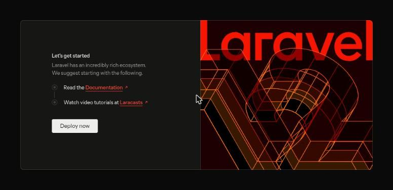

<!-- laravel-base template readme -->
# laravel-base

[](https://github.com/okarabudka/laravel-base/actions/workflows/ci.yml)

A starter kit for new Laravel projects that always starts from the newest Laravel release. The repository holds no
Laravel code. It holds the setup every new project needs before its first feature: a Docker environment, quality
checks, CI and a production build. On the first `make up` it downloads the latest Laravel and applies that setup on
top.



## Why it exists

The first day of a new Laravel project usually looks the same: write a `docker-compose.yml`, fight file permissions
in the container, set up tests and a linter, wire up CI, decide on sensible framework defaults, and only weeks later
work out how the thing will actually run in production. Each project solves this slightly differently, and the
differences cost time when you move between them.

laravel-base makes those decisions once. A template with a committed skeleton falls behind the framework. This one
installs the current Laravel release every time you start a project, so you never begin on an outdated version.
Every project started from it has the same commands, the same checks and the same production setup.

## How it works

1. `make up` runs `bin/generate` in the PHP container. It installs the newest `laravel/laravel` with Composer into a
   temporary directory.
2. The template is applied to that fresh skeleton:
   - `overlay/` adds the template's own files: the health check, request ids, strict defaults and the tests;
   - `bin/patch-skeleton.php` makes small, anchored edits to skeleton files: middleware registration, the
     `/health` route, Vite in Docker and environment defaults;
   - Pest and Larastan are installed at their latest versions.
3. The finished project moves into the repository root. If any step fails, the root is left untouched.
4. Every later `make up` just starts the containers.

In this repository the generated files are git-ignored. `make init` turns a copy into your own project. From then on
the generated code is ordinary project code that you commit.

CI generates a fresh project on every push and once a week. If a new Laravel release changes something the template
relies on, a patch anchor stops generation and CI turns red, instead of producing a half-configured project.

To pin a version: `LARAVEL_VERSION=13.11.* make up`.

## What you get

**A working project in minutes.** The latest Laravel on PHP 8.5 with SQLite. `make up` creates the TLS certificate
and `.env`, builds the containers, installs dependencies, generates the app key and runs migrations. You only need
Docker, make and openssl on your machine. PHP and Node are not required.

**A local environment close to production.** Nginx with HTTPS, PHP-FPM, Mailpit to catch outgoing mail, and Vite with
hot reload in its own container. MariaDB and Redis are one profile away. Containers run as your user, so files created
inside them stay editable on the host.

**Observability from day one.** In production, logs go to stderr as JSON. Every request gets an `X-Request-Id` that
appears in all of its log entries and in queued jobs. `/health` checks the database, cache and queue and returns
503 when one of them fails. `/up` stays the plain liveness check.

**Quality checks from the first commit.**
- Pest tests, including architecture presets that keep the code structure in shape.
- Laravel Pint for code style.
- Larastan (PHPStan) at the strictest level, tests included.

The same checks run in GitHub Actions together with a secret scan (gitleaks), a run of a freshly initialised
project and a production build.

**Strict defaults.** Eloquent fails loudly on lazy loading, unknown attributes and silently dropped fields outside
production. Dates are immutable. `migrate:fresh`, `db:wipe` and similar commands are blocked in production. Tests
cover each of these, so removing one by accident turns CI red.

**A path to production.** The same Dockerfile builds a production PHP-FPM image without dev dependencies, with an
optimised autoloader, OPcache and pre-built assets, plus an Nginx image for the public files. `compose.prod.yaml` runs
them together with a queue worker and the scheduler, with health checks on every service.

**Supply-chain care.** Frontend packages are locked only from releases at least 14 days old, and npm never runs
install scripts.

## How to use it

### Start a new project

Click **Use this template** on GitHub (or clone this repository), then:

```bash
git clone <your-repository-url> my-app && cd my-app
make init NAME=my-app
make up
git add -A && git commit -m "Start my-app from laravel-base"
```

`make init` generates the project if needed and renames it:
- sets `APP_NAME`;
- sets the Composer name (`<github-owner>/my-app`);
- replaces this README with a short project README that carries your CI badge;
- removes the template's git-ignore block, so the generated code becomes part of your project.

It is safe to run again.

### Open in Codespaces

[](https://codespaces.new/okarabudka/laravel-base)

The dev container generates the project, starts PHP, Nginx and Mailpit and forwards the app (HTTPS) and Mailpit.
It works the same way in VS Code with the Dev Containers extension.

### Just try it

```bash
git clone https://github.com/okarabudka/laravel-base.git && cd laravel-base
make up
```

Open https://localhost:8443 (self-signed certificate, accept the browser warning) and Mailpit at http://localhost:8025.
If a port is taken, change `HTTP_PORT`, `HTTPS_PORT` or `MAILPIT_PORT` in `.env` and run `make up` again.

### Day-to-day work

| Target           | What it does                                                    |
|------------------|-----------------------------------------------------------------|
| `make init`      | Turn the copy into your project: `make init NAME=my-app [VENDOR=acme]` |
| `make up`        | Generate on first run, then start containers, install, migrate  |
| `make app`       | Only generate the Laravel project (first run)                   |
| `make dev`       | `make up` plus the Vite dev server with hot reload              |
| `make down`      | Stop and remove containers                                      |
| `make sh`        | Open a shell in the PHP container                               |
| `make test`      | Run the test suite (Pest)                                       |
| `make lint`      | Check code style (Pint) and run PHPStan                         |
| `make fix`       | Fix code style (Pint)                                           |
| `make help`      | List all targets                                                |

## Development services and ports

| Service | Image                       | Port (host)                     |
|---------|-----------------------------|---------------------------------|
| web     | `nginx:1.27-alpine`         | 8443 (HTTPS), 8080 (HTTP)       |
| php     | `docker/php/Dockerfile`     | —                               |
| mail    | `axllent/mailpit`           | 8025 (UI), SMTP inside network  |
| node    | `node:22-alpine` (`dev`)    | 5173 (Vite, HTTPS)              |
| db      | `mariadb:11.4` (`full`)     | —                               |
| redis   | `redis:7-alpine` (`full`)   | —                               |

To use MariaDB and Redis, run `docker compose --profile full up -d` and switch the connection in `.env`
(`DB_CONNECTION=mariadb`, `DB_HOST=db` and the commented `DB_*` values).

## Production

`docker/php/Dockerfile` has two production targets: `app` (PHP-FPM) and `web` (Nginx with the built assets).
`compose.prod.yaml` runs them with a queue worker and the scheduler:

```bash
cp .env.example .env    # set APP_KEY, APP_URL and your database
docker compose -f compose.prod.yaml up -d --build --wait
curl http://localhost:8080/health
```

On start, the `app` container runs migrations and caches config, routes and views. TLS is expected to terminate in
front of `web`, for example at a load balancer or reverse proxy.

## Repository layout

```
bin/generate               installs the latest Laravel and applies the template
bin/patch-skeleton.php     anchored edits to skeleton files
bin/lock-assets            locks frontend packages (14-day cooldown, no install scripts)
bin/init                   turns a copy into your project
overlay/                   files the template adds to every project
docker/php/Dockerfile      dev, app (production PHP-FPM) and web (production Nginx) targets
docker/conf/               Nginx, MariaDB and TLS configuration
docker-compose.yml         local development stack
compose.prod.yaml          production-like stack with queue and scheduler
.github/                   CI workflow and Dependabot
.devcontainer/             Codespaces and VS Code dev container
```

## Status

Maintained.

## License

MIT, see [LICENSE](LICENSE).
